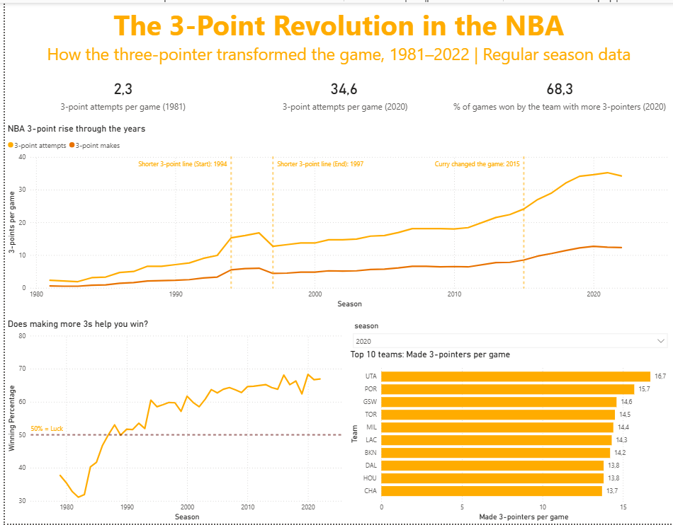

# The 3-Point Revolution in the NBA

An analysis of how the three-point shot transformed the NBA from 1981 to the present, and whether making more threes actually helps teams win.

**Tools:** SQLite · SQL (DBeaver) · Power BI



---

## Questions

1. How much has three-point shooting grown since the line was introduced?
2. Has accuracy kept up with the volume?
3. Does the team that makes more threes win more often?
4. Which teams led the revolution?

## Data

- **Source:** [NBA Database (Kaggle)](https://www.kaggle.com/datasets/wyattowalsh/basketball), SQLite file `nba.sqlite`
- **Table used:** `game` (one row per game, with home and away box-score stats)
- **Scope:** Regular-season games only (`season_type = 'Regular Season'`)
- **Season label:** the year the season started (e.g. `2020` = the 2020-21 season)

## Method

1. Explored the database in DBeaver and checked how complete the 3-point stats were for each season.
2. Reshaped each game into two "team-game" rows (home + away) with `UNION ALL`, so every row is one team in one game.
3. Aggregated per season and per team-season with SQL (queries below).
4. Exported the results to CSV and built the visuals in Power BI.

## Key Findings

### 1. Three-point volume exploded
- Attempts per team per game rose from **2.3 in 1981** to **34.6 in 2020-21**, roughly **15 times** as many.
- Made threes rose from **0.6** to about **12–13 per game**.
- The growth accelerated sharply after about 2012, in the era of analytics and the Golden State Warriors.

### 2. The shortened line left a visible mark (1994–1997)
- The NBA moved the corner-to-arc line closer for three seasons. Attempts jumped from **9.9 (1993)** to **15.3–16.8 (1994–96)**.
- When the line moved back, attempts dropped to **12.7 in 1997**.

### 3. Accuracy improved early, then plateaued
- 3P% climbed from about **27% (1981)** to about **36% by the mid-1990s**, and has stayed in the **34–37%** range since.
- In other words, teams did not start shooting more because they suddenly got more accurate. They shot more because a 36% three is worth more points than a typical mid-range two.

### 4. Making more threes is linked to winning, and the link has grown stronger
- In the early 1980s, the team that made more threes won **less than 50%** of the time. Threes were mostly a late-game catch-up shot for trailing teams.
- Around **1988** the relationship flipped above 50%.
- In the 2020-21 season, the team with more made threes won **68.3%** of games, about **2 out of every 3**.

### 5. Top teams
- In the 2020-21 season, **Utah** led the league with **16.7 made threes per game**.
- *(Add your own observations from the slicer, e.g. how often Houston led during 2016–2019, or where Golden State ranked in 2015.)*

## Limitations

- **Correlation, not causation.** Teams that make more threes may simply be better teams overall.
- **Missing early seasons.** The 3-point line was introduced in 1979-80, but 3-point stats in the dataset start in 1981.
- **Franchise changes.** Some teams changed city or abbreviation (e.g. SEA → OKC, NJN → BKN, CHH → NOH → NOP), so the same franchise can appear under different codes.
- **Regular season only.** Playoff games were excluded.

## SQL Queries

### Season-level trends
```sql
WITH team_games AS (
  SELECT season_id, fga_home AS fga, fg3a_home AS fg3a, fg3m_home AS fg3m, pts_home AS pts
  FROM game WHERE season_type = 'Regular Season'
  UNION ALL
  SELECT season_id, fga_away, fg3a_away, fg3m_away, pts_away
  FROM game WHERE season_type = 'Regular Season'
)
SELECT CAST(substr(season_id, 2) AS INT)            AS season,
       ROUND(AVG(fg3a), 1)                          AS three_pa_per_game,
       ROUND(AVG(fg3m), 1)                          AS three_pm_per_game,
       ROUND(100.0 * SUM(fg3m) / SUM(fg3a), 1)      AS three_pct,
       ROUND(100.0 * SUM(fg3a) / SUM(fga), 1)       AS share_of_shots_3pt,
       ROUND(100.0 * SUM(3 * fg3m) / SUM(pts), 1)   AS share_of_points_3pt
FROM team_games
WHERE fg3a IS NOT NULL AND CAST(substr(season_id, 2) AS INT) >= 1979
GROUP BY season
ORDER BY season;
```

### Made threes per team-season
```sql
WITH team_games AS (
  SELECT season_id, team_abbreviation_home AS team, fg3m_home AS fg3m FROM game WHERE season_type = 'Regular Season'
  UNION ALL
  SELECT season_id, team_abbreviation_away, fg3m_away FROM game WHERE season_type = 'Regular Season'
)
SELECT CAST(substr(season_id, 2) AS INT) AS season, team,
       ROUND(AVG(fg3m), 1) AS three_pm_per_game
FROM team_games
WHERE fg3m IS NOT NULL
GROUP BY season, team
ORDER BY three_pm_per_game DESC;
```

### Does the team with more made threes win?
```sql
SELECT CAST(substr(season_id, 2) AS INT) AS season,
       ROUND(100.0 * AVG(CASE
         WHEN (fg3m_home > fg3m_away AND wl_home = 'W')
           OR (fg3m_away > fg3m_home AND wl_home = 'L') THEN 1.0 ELSE 0 END), 1)
         AS pct_team_with_more_3s_won
FROM game
WHERE season_type = 'Regular Season'
  AND fg3m_home IS NOT NULL AND fg3m_home <> fg3m_away
GROUP BY season
ORDER BY season;
```

## Power BI Notes

- The CSVs use `.` as the decimal separator. On a Greek-locale system, numeric columns must be converted in Power Query with **Change Type → Using Locale → English (United States)**. Otherwise `2.3` is read as `23`.
- The `season` column is set to *Don't summarize* in every table.

## Repository Structure

| File | Description |
|---|---|
| `README.md` | Project overview and findings |
| `three_point_revolution.sql` | All SQL queries used |
| `seasons.csv` | League-wide 3-point stats per season |
| `3pts_made.csv` | Made 3-pointers per game for every team-season |
| `Does_3pt_win_games.csv` | Win % of the team with more made 3s, per season |
| `NBA 3-POINT REVOLUTION.pbix` | Power BI report |
| `nba_project_dashboard.png` | Dashboard screenshot |
